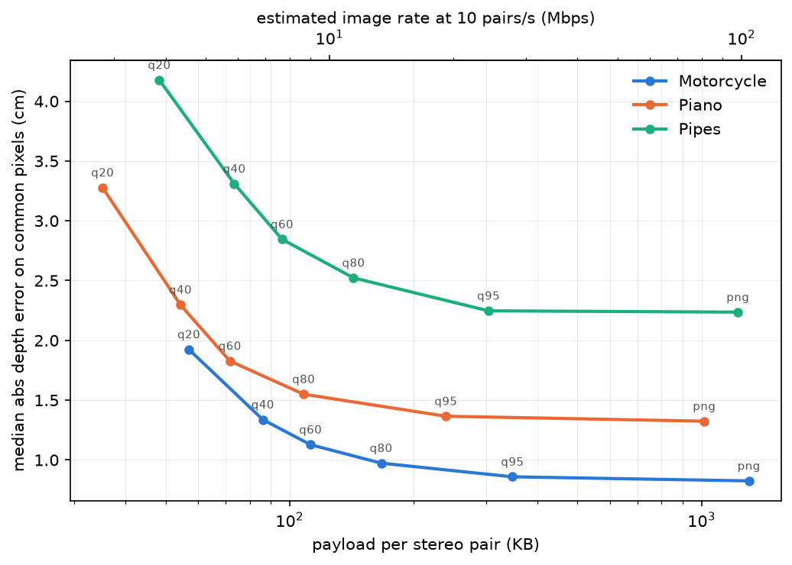
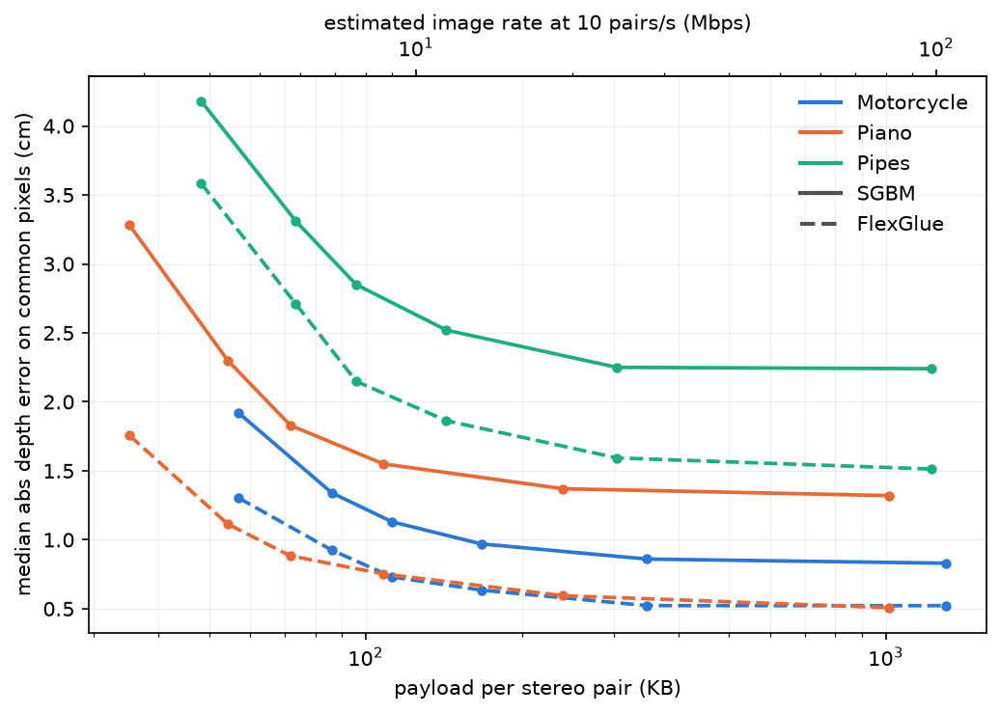

# NeuralStereo

> I measured the reference results using the original benchmark environment. This checkout pins FlexGlue v0.1. The learned comparison uses the FlexGlue revision from the benchmark environment.

**Stereo depth estimation for bandwidth-limited robot cameras: how much JPEG
compression can a stereo pair take before distance estimates become unreliable,
with a classical matcher and with a learned one?**

This is my project on stereo vision under a bandwidth budget. I built it the same
way as my OFDM, ECG and radar projects: a fixed classical baseline, one controlled
variable, measured numbers only, and then a learned stage compared against the
classical one on exactly the same data. A robot that streams camera images over a
radio link (I have streamed video from an ESP32-CAM, which is where the question
comes from) pays for every byte. JPEG shrinks the payload, but it also blurs the
fine texture that stereo matching depends on. I measured that trade-off on three
Middlebury 2014 scenes with ground-truth disparity, first with OpenCV's SGBM
(stage 1), then with FlexGlue, a 2026 learned matcher (stage 2).

```text
im0.png, im1.png (quarter resolution, rectified)
      -> JPEG encode each view at quality q, record actual bytes
      -> decode
      -> stage 1: grayscale -> StereoSGBM (fixed settings per scene)
         stage 2: every im0 pixel as a query -> FlexGlue -> match in im1
                  -> disparity = x0 - x1, filtered by the model's own
                     validity checks and a 2 px epipolar row check
      -> disparity d -> depth Z = baseline * f / (d + doffs)
      -> compare against disp0GT.pfm: coverage, bad-2px rate,
         median abs depth error (all valid pixels, and pixels
         valid in both this run and the PNG baseline run)
```

The baseline condition is the untouched PNG pair. The compressed conditions are
JPEG qualities 95, 80, 60, 40 and 20, each view encoded independently, which is
how a simple robot camera (MJPEG style) would send them. Everything else is held
fixed per scene: resolution, matcher settings, and the depth conversion. The
`doffs` term is the principal-point offset between the two rectified views; the
depth formula is wrong without it, and a unit test pins it.

## Setup

I use Python 3.12 and [uv](https://docs.astral.sh/uv/). `uv.lock` pins every
package. Stage 1 needs only numpy, opencv-python and matplotlib; stage 2 adds
PyTorch (the lock file points at the CUDA 12.8 build of torch 2.9.1) and
FlexGlue pinned to a commit. From the project folder:

```powershell
uv sync --extra neural
uv run pytest -q --basetemp=.pytest-tmp
```

Use these commands to run the two studies.

```powershell
uv run python scripts/run_compression_study.py
uv run --extra neural python scripts/run_learned_study.py
```

## Dataset

Three scenes from the Middlebury 2014 stereo dataset (Motorcycle, Piano, Pipes)
at the official quarter resolution (about 740 x 490), from the MiddEval3
training release, with ground-truth disparity (`disp0GT.pfm`) and per-scene
calibration (`calib.txt`). The download script fetches only these scenes and
`data/` stays out of the repository. Quarter resolution keeps every run fast on
a laptop and is close to what a small robot camera would actually transmit.

## Metrics

- **coverage**: share of ground-truth-valid pixels where the matcher returned a
  disparity that passed its validity checks.
- **bad2px**: share of ground-truth-valid pixels whose disparity is off by more
  than 2 px, counting missing estimates as wrong (Middlebury convention). The
  2 px threshold is at quarter resolution. Plain SGBM sits in the 22-34 % range
  on these scenes even uncompressed; the point is the change, not the level.
- **median abs depth error**: median of |estimated - true| depth in cm over
  pixels valid in both the estimate and the ground truth. I also report it on
  the pixels valid in **both** the compressed run and that matcher's PNG
  baseline run, so a compressed run cannot look more accurate just by dropping
  the hard pixels. The conclusions below use this common-pixel number.

Payload is the actual encoded byte size of the pair. The Mbps column assumes 10
stereo pairs per second and is an estimate (bytes x 8 x 10 / 1e6), not a
measured link rate.

## Stage 1: classical matching (SGBM)

OpenCV StereoSGBM on grayscale, one fixed configuration per scene
(`numDisparities` from the scene's `ndisp`, blockSize 5, MODE_SGBM_3WAY).
All 18 runs (`results/results.csv`):

| scene | cond | KB/pair | Mbps est. | coverage % | bad2px % | med err cm | common cm |
|---|---|---|---|---|---|---|---|
| Motorcycle | png | 1303 | 104.3 | 85.0 | 22.6 | 0.83 | 0.83 |
| Motorcycle | q95 | 348 | 27.8 | 85.0 | 22.8 | 0.86 | 0.86 |
| Motorcycle | q80 | 167 | 13.3 | 84.6 | 23.3 | 0.99 | 0.97 |
| Motorcycle | q60 | 112 | 9.0 | 84.1 | 24.5 | 1.14 | 1.13 |
| Motorcycle | q40 | 86 | 6.9 | 83.5 | 26.0 | 1.36 | 1.34 |
| Motorcycle | q20 | 57 | 4.6 | 81.7 | 30.1 | 1.96 | 1.92 |
| Piano | png | 1016 | 81.3 | 82.0 | 34.0 | 1.32 | 1.32 |
| Piano | q95 | 240 | 19.2 | 81.4 | 34.5 | 1.40 | 1.37 |
| Piano | q80 | 108 | 8.7 | 81.5 | 35.8 | 1.63 | 1.55 |
| Piano | q60 | 72 | 5.7 | 81.2 | 37.8 | 1.96 | 1.83 |
| Piano | q40 | 54 | 4.3 | 79.2 | 41.1 | 2.50 | 2.30 |
| Piano | q20 | 35 | 2.8 | 78.6 | 47.1 | 3.65 | 3.28 |
| Pipes | png | 1226 | 98.0 | 78.3 | 33.1 | 2.24 | 2.24 |
| Pipes | q95 | 304 | 24.3 | 78.1 | 33.5 | 2.29 | 2.25 |
| Pipes | q80 | 143 | 11.4 | 77.3 | 34.9 | 2.61 | 2.52 |
| Pipes | q60 | 96 | 7.7 | 77.1 | 36.2 | 3.00 | 2.85 |
| Pipes | q40 | 73 | 5.9 | 76.3 | 37.6 | 3.51 | 3.31 |
| Pipes | q20 | 48 | 3.9 | 74.8 | 42.0 | 4.55 | 4.18 |



Per-scene visual grids with a shared color scale per scene:
[Motorcycle](results/motorcycle_grid.png), [Piano](results/piano_grid.png),
[Pipes](results/pipes_grid.png).

Compression barely matters until the texture starts to go. Quality 95 cuts the
payload by about 4x and moves the error by at most 0.03 cm. The curve has a
knee around quality 40: from there down, error and coverage fall away faster.
**Piano was the most sensitive scene** (bad2px up 13.1 points png to q20,
common-pixel error 2.5x), because JPEG wipes out the faint texture on its flat
surfaces - the dark piano body, the wall, the lampshade - first. In the grids
the failures sit in flat low-texture regions (lost coverage, wrong patches),
at depth discontinuities (blocky artifacts shift the matched edge), and in the
far background, where at small disparity a fraction of a pixel of disparity
error is a lot of depth.

## Stage 2: learned matching (FlexGlue)

[FlexGlue](https://github.com/cvg/FlexGlue) (Lindenberger, Sarlin, Miksik,
Pollefeys, 2026) is a sparse-to-dense matcher: it encodes both images with a
DINOv3-ConvNeXt backbone, refines the features with a transformer, and predicts
for any query point in one image its correspondence in the other, with a
confidence and validity checks of its own. It is not a stereo method and knows
nothing about epipolar geometry, so I use it asymmetrically: every pixel of
`im0` is a query (in COLMAP corner convention), the predicted point in `im1`
gives disparity as its x-shift, and I keep a match only if the model marks it
valid, the predicted point stays within 2 px of the query's row (the rectified
geometry says it should), and the disparity is inside the scene's range. One
fixed configuration (`refine=True`, defaults) across all scenes and conditions.
The mean row deviation of its valid matches is 0.14-0.39 px per run, so its
unconstrained predictions do respect the rectified geometry.

All 18 runs (`results/results_flexglue.csv`):

| scene | cond | KB/pair | coverage % | bad2px % | med err cm | common cm |
|---|---|---|---|---|---|---|
| Motorcycle | png | 1303 | 92.4 | 14.5 | 0.52 | 0.52 |
| Motorcycle | q95 | 348 | 92.5 | 14.6 | 0.53 | 0.52 |
| Motorcycle | q80 | 167 | 92.6 | 15.2 | 0.64 | 0.64 |
| Motorcycle | q60 | 112 | 92.8 | 15.5 | 0.74 | 0.73 |
| Motorcycle | q40 | 86 | 92.7 | 15.9 | 0.94 | 0.92 |
| Motorcycle | q20 | 57 | 92.7 | 17.1 | 1.33 | 1.30 |
| Piano | png | 1016 | 94.6 | 9.5 | 0.51 | 0.51 |
| Piano | q95 | 240 | 94.7 | 9.8 | 0.60 | 0.59 |
| Piano | q80 | 108 | 94.9 | 10.6 | 0.76 | 0.75 |
| Piano | q60 | 72 | 95.0 | 12.1 | 0.89 | 0.88 |
| Piano | q40 | 54 | 95.1 | 12.6 | 1.13 | 1.11 |
| Piano | q20 | 35 | 95.2 | 15.0 | 1.79 | 1.76 |
| Pipes | png | 1226 | 85.3 | 26.3 | 1.51 | 1.51 |
| Pipes | q95 | 304 | 85.4 | 26.7 | 1.63 | 1.59 |
| Pipes | q80 | 143 | 85.5 | 27.7 | 1.93 | 1.86 |
| Pipes | q60 | 96 | 85.1 | 28.8 | 2.24 | 2.15 |
| Pipes | q40 | 73 | 85.4 | 29.6 | 2.85 | 2.71 |
| Pipes | q20 | 48 | 85.8 | 31.1 | 3.79 | 3.58 |



FlexGlue grids: [Motorcycle](results/motorcycle_grid_flexglue.png),
[Piano](results/piano_grid_flexglue.png),
[Pipes](results/pipes_grid_flexglue.png). Their error color scale is set per
matcher from each baseline run (about 7 cm for FlexGlue's Piano grid against
about 35 cm for SGBM's), so compare matchers through the comparison plot and
the tables, not across grids.

What I found, comparing on each matcher's own common pixels:

- **FlexGlue beats SGBM on every scene before any compression**: 0.52 / 0.51 /
  1.51 cm median error against 0.83 / 1.32 / 2.24 cm, with 7-13 points more
  coverage.
- **SGBM's weakest scene becomes FlexGlue's best.** Piano, the textureless
  scene that hurt SGBM most, has FlexGlue's lowest bad2px rate (9.5 % against
  SGBM's 34.0 %). Learned features carry context beyond local texture, which is
  exactly what the flat surfaces need.
- **Compression costs FlexGlue accuracy but almost no coverage.** From png to
  q20 its coverage stays within half a point (Piano even rises slightly, from
  94.6 to 95.2 - its validity checks accept marginally more, which is why the
  common-pixel error column is the one to trust), while SGBM loses 2.0-3.4
  points. The error still grows 2.4-3.5x at q20, so learned matching does not
  remove the trade-off; it shifts the whole curve down.
- **At matched accuracy, FlexGlue buys roughly one quality step, and against
  the uncompressed classical baseline it buys an order of magnitude.** On
  Piano, FlexGlue at q40 (54 KB) reaches 1.11 cm, better than SGBM on the
  uncompressed PNGs (1.32 cm at 1016 KB) - 19x fewer bytes. On Motorcycle,
  FlexGlue at q60 (112 KB, 0.73 cm) beats SGBM's PNG baseline (1303 KB,
  0.83 cm).
- **The compute trade.** On my laptop, SGBM takes 33 ms per pair on CPU;
  FlexGlue takes 0.61 s per pair on the RTX 3050 after warm-up. So FlexGlue as
  configured here sustains about 1.6 pairs/s, not the 10 pairs/s the Mbps
  column assumes, and the right reading is: spend compute on the receiver to
  save radio bandwidth, when the receiver has a GPU.

## The setting I would pick

With SGBM: **JPEG quality 80**. It cuts the payload by 87-89 % (8.7-13.3 Mbps
estimated at 10 pairs/s, versus 81-104 Mbps for PNG) and costs 0.14-0.28 cm of
median depth error, 0.7-1.8 points of bad2px, and at most half a point of
coverage. Below q40 the estimates degrade quickly.

With FlexGlue on the receiver: **JPEG quality 40**. At 54-86 KB per pair
(4.3-6.9 Mbps estimated) it still matches or beats what SGBM achieves on
uncompressed images on every scene (0.92 / 1.11 / 2.71 cm against 0.83 / 1.32 /
2.24 cm), with 7-16 points more coverage. The link budget drops by roughly 15x
against PNG, paid for with about 0.6 s of GPU time per pair.

## Limitations and next steps

- Independent JPEG per view is a proxy for a simple MJPEG-style camera stream.
  A video codec (H.264/H.265) with inter-frame prediction would behave
  differently at the same bit rate.
- The 2 px bad-pixel threshold is at quarter resolution (8 px at full). SGBM
  matches on grayscale after color decoding; FlexGlue sees the color images.
- Coverage depends on each matcher's own validity rules (SGBM's uniqueness and
  speckle checks; FlexGlue's confidence, cycle and covisibility checks at
  default thresholds plus my 2 px row check), so cross-matcher coverage is not
  an identical yardstick; the common-pixel error columns are.
- FlexGlue here is one configuration of one learned matcher, used zero-shot.
  Tuning it (resolution, thresholds), constraining it to the epipolar line, or
  fine-tuning on compressed pairs could all shift its curve further.
- FlexGlue's DINOv3 ConvNeXt-B backbone weights are under Meta's DINOv3
  license; the FlexGlue code and remaining weights are MIT, and the RoMa v2
  refiner is MIT.

## Data and references

- D. Scharstein, H. Hirschmuller, Y. Kitajima, G. Krathwohl, N. Nesic, X. Wang,
  P. Westling. "High-resolution stereo datasets with subpixel-accurate ground
  truth." GCPR 2014. Dataset: https://vision.middlebury.edu/stereo/data/scenes2014/
- P. Lindenberger, P.-E. Sarlin, O. Miksik, M. Pollefeys. "FlexGlue:
  Sparse-to-Dense Feature Matching and Visual Disambiguation." arXiv:2610.32976.
  Code: https://github.com/cvg/FlexGlue
- Anaum Ghori, "StereoReconstruction" in 3D-geometric-vision
  (https://github.com/anaumghori/3D-geometric-vision), a from-scratch SGM
  pipeline I used as a technical reference for the matching and evaluation
  concepts. No code was copied from it; this project uses OpenCV's StereoSGBM.
